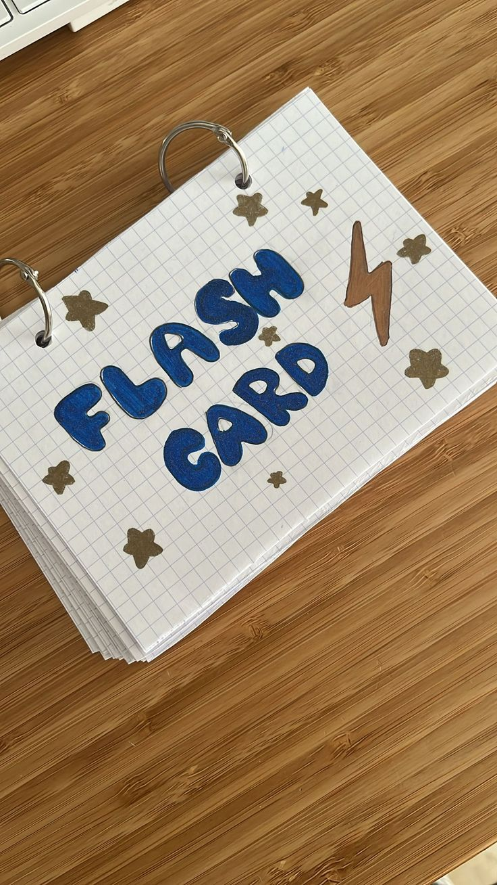

# ⚡ Azure Flashcard Coach

> A spaced-repetition study tool built from a real AZ-900 learning struggle.  
> **Live demo:** run `npm install --legacy-peer-deps` then `npm run dev`



---

## 🎯 The Problem

Studying for Azure certifications means memorising hundreds of services, acronyms, and concepts. Most learners forget them faster than they learn them — cramming the night before doesn't build real memory. This tool was born from that exact frustration during AZ-900 prep.

---

## 💡 The Solution

Azure Flashcard Coach uses the **SM-2 spaced repetition algorithm** — the same science behind Anki and Duolingo. Instead of drilling every card equally, it learns which Azure concepts you keep getting wrong and surfaces them more often, while spacing out the ones you already know.

---

## ✨ Features

| Feature | Description |
|---|---|
| 🃏 **3D Card Flip** | Smooth CSS perspective flip animation — question front, answer back |
| 🧠 **SM-2 Algorithm** | Scientifically proven spaced repetition — focuses on your weak spots |
| 📊 **Progress Dashboard** | Mastery levels, accuracy rate, per-category progress, daily streak |
| 🎯 **4-Rating System** | Missed it / Almost / Got it / Perfect — feeds directly into SM-2 |
| 💡 **AI Hint Prompts** | Structured prompts to help you understand concepts you keep missing |
| 🗂️ **Category Filter** | Drill into specific domains: Networking, Security, Identity, and more |
| 💾 **Local Persistence** | Progress saved in localStorage — pick up exactly where you left off |
| 📱 **Responsive** | Works on desktop and mobile |

---

## 📚 Card Categories (50 cards total)

- Core Concepts — Regions, Availability Zones, Resource Groups, ARM, Subscriptions
- Compute — VMs, App Service, AKS, Azure Functions, Scale Sets, ACI
- Storage — Blob, Queue, Table, Files, Redundancy options (LRS/ZRS/GRS)
- Networking — VNet, NSG, Load Balancer, Application Gateway, VPN, ExpressRoute
- Identity — Microsoft Entra ID, RBAC, Managed Identity, Conditional Access
- Security — Key Vault, Defender for Cloud, Sentinel, DDoS Protection
- Monitoring — Azure Monitor, Log Analytics, Application Insights, Service Health
- Databases — Azure SQL, Cosmos DB, Cache for Redis
- Governance — Azure Policy, Cost Management, Tags, Blueprints
- DevOps — Azure DevOps, Service Bus, Event Grid, Logic Apps, IaC

All content is aligned to the **AZ-900 Microsoft Azure Fundamentals** exam objectives.

---

## 🔍 Prompt Engineering

When a card is missed, the app surfaces a structured AI prompt designed to explain the concept from first principles:

```
You are an Azure study coach. Explain "[concept]" to someone preparing 
for AZ-900 using: 1) a one-line definition, 2) a real-world analogy, 
3) the key exam fact they need to remember.
```

This prompt pattern — **Define → Analogy → Exam hook** — is specifically engineered for retention, not just understanding.

---

## 🧠 How SM-2 Works

Each card tracks: **interval** (days until next review), **ease factor**, and **repetition count**.

After each answer:
- Rating < 3 (Missed/Almost) → card resets to Day 1, comes back tomorrow
- Rating ≥ 3 (Got it/Perfect) → interval grows: 1 day → 6 days → `interval × ease factor`
- Ease factor adjusts based on how hard the card was (bounded 1.3–2.5)

---

## 🚀 Getting Started

```bash
# Clone the repo
git clone https://github.com/Kingsavannah44/Flashcard-coach.git
cd Flashcard-coach

# Install dependencies
npm install --legacy-peer-deps

# Start dev server
npm run dev
```

Open **http://localhost:5173**

---

## 🛠️ Tech Stack

| Layer | Technology |
|---|---|
| Frontend | React 18 + Vite 5 |
| Styling | Pure CSS (no framework) — custom dark theme |
| Algorithm | SM-2 Spaced Repetition |
| Persistence | localStorage |
| Build | Vite — 39 modules, ~171KB JS bundle |

---

## 👥 Target Users

- **AZ-900 candidates** cramming for their first Azure certification
- **Bootcamp students** learning cloud fundamentals
- **IT professionals** upskilling to Azure from other cloud platforms
- **Learners who've failed AZ-900** and need a smarter revision method

---

## 📈 Impact & Scalability

This tool is built to grow:

- **More certifications** — AZ-104, AZ-204, AZ-305 card decks can be added by dropping a new data file
- **AI integration** — the prompt engineering layer can connect to OpenAI/Azure OpenAI for dynamic explanations
- **Team study** — progress could sync via a lightweight backend for classroom or cohort use
- **Exam mode** — timed quiz simulating real AZ-900 exam pressure (60 questions, 45 minutes)
- **Custom cards** — learners could add their own cards from personal notes

---

## 🏗️ Project Structure

```
src/
├── assets/          # Logo and images
├── components/
│   ├── FlashCard.jsx        # 3D flip card + rating buttons
│   ├── Header.jsx           # Nav, category filter, mini stats
│   ├── ProgressDashboard.jsx # Stats modal
│   └── SessionComplete.jsx  # End-of-session screen
├── data/
│   └── azureCards.js        # 50 AZ-900 flashcards
├── hooks/
│   └── useSM2.js            # SM-2 algorithm + localStorage
├── App.jsx                  # Main app logic + session flow
└── App.css                  # Complete stylesheet
```

---

## 🎤 Hackathon Context

**Theme:** Building Smarter Exam Prep Tools from Our Own Learning Journey  
**Challenge:** Memory & Revision — Flashcard Coach  
**Problem:** Learners struggle to remember Azure terms, services, and concepts  
**Solution:** Spaced repetition that focuses on what you keep getting wrong

*Built for the Hackathon · October 2026*
